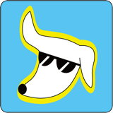
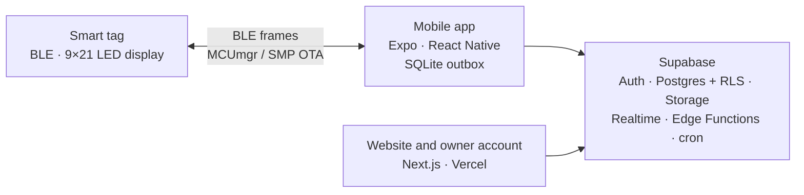
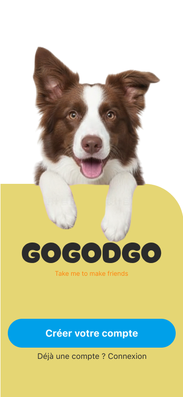

# gogoDgo: smart dog tag, app and community

gogoDgo is a Bluetooth (BLE) dog tag with an LED display, plus a mobile app and an online community. The dog, not the owner, is the social profile. When two tags meet in real life the app records the encounter, and the owners can choose to become friends.

**Website:** [www.gogodgo.fr](https://www.gogodgo.fr)

> **Case study page.** gogoDgo is an early-stage startup and its source code is private. This page covers the product, my role and the architecture.

| | |
|---|---|
| **Period** | November 2025 – today |
| **My role** | Technical co-founder in a team of 4 |
| **Status** | Website in production. iOS and Android preview builds. BLE protocol and OTA updates validated in simulation. On-device tests with the first hardware prototype are in progress |

## My role

- **Product architecture.** I wrote the functional architecture and the V1 scope, and designed the screens in Figma.
- **Data model.** I designed the PostgreSQL database on Supabase. Owners, dogs and devices are separate entities, protected by row-level security.
- **Software.** I built the app and the web dashboard connected to the tag prototype: activity history, device status and display settings, Last Seen / Lost. Multilingual content is translated with the OpenAI API.
- **Coordination.** I am the technical link between hardware, design, marketing and our manufacturing partner in China.

## Product decisions

- **The dog is the profile.** Owner identity and contact details are private by default. Owners share them only by choice.
- **Real encounters, mutual friendships.** Tags detect each other nearby. The app notifies both owners, and a friendship exists only when both accept it.
- **One account, several dogs.** Switching dog never unpairs a device.
- **Pairing is not ownership.** A connected tag is not a bound tag. Binding, unbinding and transfer are explicit steps.
- **We don't overstate what the hardware can do.** The tag has no GPS. "Last Seen" uses the phone's location and time, and the app says so.

## Architecture

- **Offline-first sync.** Activity records from the tag are written to the phone first. The app acknowledges them to the tag only after they are saved, and uploads them through an outbox when the network is back.
- **Shared protocol package.** BLE frames, records and the OTA flow live in one tested `device-protocol` package used by the app.
- **Monorepo.** pnpm and Turborepo, with `apps/web`, `apps/mobile`, `packages/*` and `supabase/`. GitHub Actions run quality checks and a release gate.
- **Tests.** 589 database tests, 66 protocol tests, 182 mobile tests and 23 web tests, plus HTTP checks across several accounts against a local Supabase.

## Screens

## Stack

`TypeScript` `Next.js` `React` `Tailwind CSS` `Expo` `React Native` `Supabase` `PostgreSQL` `BLE` `GitHub Actions` `Vercel` `OpenAI API` `Figma`
